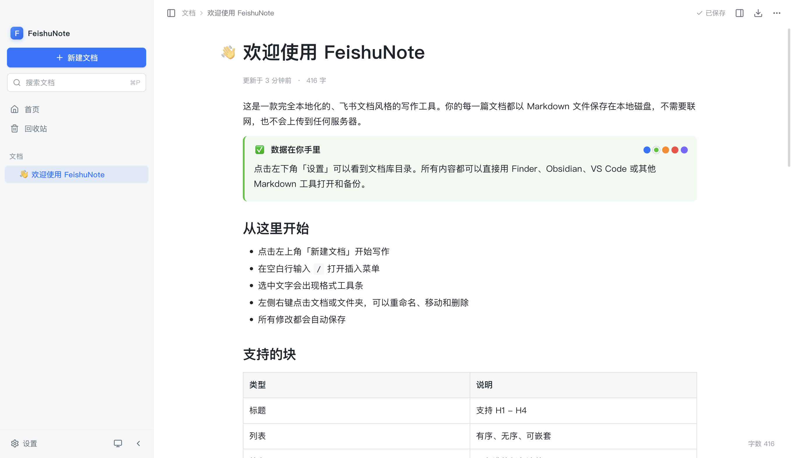

# FeishuNote

> 一款完全本地化、飞书文档风格的桌面写作客户端，支持 macOS 与 Windows 10/11。文档以 Markdown 保存在本地，随时可迁移，不需要账号，也不会上传任何数据。



## 特性

- **飞书风格编辑体验**：块级编辑器、段落左侧「+」格式面板、斜杠菜单、选中文字浮动工具条、块拖拽手柄、自动保存
- **段落左侧「+」**：光标所在段落左侧常驻加号，点击后用三列网格展示全部格式，支持键盘方向键选择；悬停其他段落同样可用
- **富内容块**：标题、列表、待办、引用、代码块（语法高亮 / 语言切换 / 复制）、表格、图片、高亮块、折叠块、分栏
- **导入 Markdown**：支持从文件对话框、首页按钮、菜单或直接拖入左侧文档树导入 `.md` 文件/文件夹，本地图片会自动复制到 `.assets` 并重写引用
- **粘贴 Markdown**：直接粘贴 Markdown 文本会自动转换为富文本；`⌘⌥V`（Windows 为 `Ctrl+Alt+V`）可强制按 Markdown 粘贴
- **本地优先**：每篇文档对应磁盘上的一个 `.md` 文件，资源放在同名 `.assets` 文件夹
- **文档管理**：文件夹树、拖拽移动、置顶、最近打开、回收站、重命名、自动同步文件系统变化
- **检索**：⌘P 快速打开、⌘⇧F 全文搜索（SQLite FTS5，对中文友好）、⌘F 文内查找
- **版本历史**：修改间隔超过 5 分钟自动保留快照，最多 20 份，可一键恢复
- **导出**：PDF（A4 打印样式）、独立 HTML（图片自动拷贝）、Markdown
- **外观**：浅色 / 深色 / 跟随系统，正文字号与正文宽度可调
- **macOS 原生**：Intel 与 Apple Silicon 分别打包，均为原生 Mach-O，不使用 Rosetta
- **Windows 10/11**：原生 x64 安装包，支持自定义标题栏、Windows 快捷键与资源管理器集成
- **快捷键与原生菜单**：macOS 显示 ⌘，Windows 显示 Ctrl；两套系统均有完整菜单与窗口行为

## 技术栈

- Electron 45 + electron-vite 6 + Vite 8
- React 19 + TypeScript
- Tiptap 3 / ProseMirror（Markdown 双向序列化）
- better-sqlite3（FTS5 索引，N-API 预编译，无需本地编译）
- 原生 CSS 变量主题，无 UI 框架依赖

## 开发

环境要求：macOS 12+、Node.js 22+、pnpm 11+。

```bash
pnpm install
pnpm dev          # 开发模式（自动打开 Electron 窗口）
pnpm typecheck    # TypeScript 检查
pnpm test         # Vitest 单元测试（Markdown 扩展语法、资源路径）
pnpm build        # 生产构建
pnpm dist         # 同时打包 macOS x64 + arm64 DMG
pnpm dist:x64     # 只打包 macOS Intel 版本
pnpm dist:arm64   # 只打包 macOS Apple Silicon 版本
pnpm dist:win     # 打包 Windows 10/11 x64 安装包
pnpm dist:all     # macOS 双架构 + Windows 安装包（在 macOS 上执行）
```

开发模式会开启 `--remote-debugging-port=9222`，便于用 Playwright 连接调试（见 `scripts/shot.mjs`）。

## 数据格式

文档库默认位于 `~/Documents/FeishuNote`，可在设置中更改：

```
FeishuNote/
├── 工作/周报.md
├── 工作/周报.assets/
│   └── mw09g5ke-image.png
├── .trash/                      # 回收站
├── .history/<docId>/            # 历史版本快照
└── .feishunote/index.db         # 可重建的索引缓存
```

每个文档带一段 YAML frontmatter：

```markdown
---
id: daqw8eMbyIA
title: 产品周会纪要
icon: 📝
created: "2026-11-03T05:41:49.176Z"
updated: "2026-11-03T05:58:42.349Z"
pinned: true
---
```

### Markdown 扩展

标准 Markdown 覆盖大部分内容；为了无损表达飞书的块模型，额外使用：

| 飞书块 | 存储写法 |
| --- | --- |
| 高亮块 | Obsidian / GitHub 风格：`> [!NOTE] 标题` + 引用内容 |
| 折叠块 | `<details><summary>标题</summary>` + Markdown 内容 |
| 分栏 | `:::columns {cols="2"}` / `:::column` 围栏 |
| 高亮 | `==文字==`（GFM 扩展） |
| 图片 | `` |

这样高亮块和折叠块可以被 Obsidian、GitHub 等工具直接识别；分栏是少数需要本应用渲染的扩展语法。图片使用相对路径，移动文档时资源目录会一起移动并自动重写引用。

## 快捷键

macOS 使用 ⌘，Windows 使用 Ctrl；下表中以 macOS 写法展示。

| 操作 | macOS 快捷键 |
| --- | --- |
| 新建文档 / 新建文件夹 | ⌘N / ⌘⇧N |
| 快速打开 / 全文搜索 | ⌘P / ⌘⇧F |
| 保存 | ⌘S |
| 加粗 / 斜体 / 下划线 | ⌘B / ⌘I / ⌘U |
| 链接 / 行内代码 | ⌘K / ⌘E |
| 标题 1–4 / 正文 | ⌘⌥1–4 / ⌘⌥0 |
| 有序 / 无序 / 待办 | ⌘⇧7 / ⌘⇧8 / ⌘⇧9 |
| 代码块 | ⌘⌥C |
| 文内查找 | ⌘F |
| 侧边栏 / 大纲 | ⌘\ / ⌘⇧O |
| 设置 | ⌘, |
| 导入 Markdown | ⌘⇧I |
| 粘贴为 Markdown | ⌘⌥V |

## 安装

选择与你的系统对应的安装包：

| 系统 / 芯片 | 安装包 |
| --- | --- |
| macOS Apple Silicon（M1/M2/M3/M4…） | `release/FeishuNote-0.1.3-arm64.dmg` |
| macOS Intel | `release/FeishuNote-0.1.3-x64.dmg` |
| Windows 10 / 11（x64） | `release/FeishuNote-Setup-0.1.3-x64.exe` |

首次启动会在用户「文稿」目录下创建 `FeishuNote` 文档库并生成《欢迎使用 FeishuNote》：

- macOS：`~/Documents/FeishuNote`
- Windows：`%USERPROFILE%\Documents\FeishuNote`

macOS 使用 ad-hoc 签名，Windows 未做代码签名。首次打开如果被 Gatekeeper / SmartScreen 拦截：

- macOS：Finder 中右键应用 →「打开」
- Windows：点击「更多信息」→「仍要运行」

Windows 安装包默认按当前用户安装，无需管理员权限，可选择安装目录，并创建桌面与开始菜单快捷方式。

## 导入与粘贴

### 导入外部 Markdown

- 菜单「文件 → 导入 Markdown…」
- 首页右上角「导入」按钮
- 左侧文档树「导入 Markdown」按钮 / 文件夹右键菜单
- 直接把 `.md` 文件或包含 `.md` 的文件夹拖到左侧文档树

导入时会：

- 为每篇文档生成新的 frontmatter id，避免与现有文档冲突
- 保留 frontmatter 中的标题、图标、创建时间、标签
- 自动复制 Markdown 中引用的本地图片到「文档名.assets」目录，并重写为相对路径
- 保留原有 Markdown 内容；同名文件会自动追加 `2`、`3`

导入到文件夹时，会把文件放到该文件夹；导入文件夹时，会递归收集其中的 `.md`（最多 500 个）。

### 粘贴 Markdown

编辑器会自动识别剪贴板中的 Markdown（标题、列表、待办、引用、代码块、表格、折叠块、链接、加粗等），直接粘贴即可得到富文本。

- 如果剪贴板来自网页/飞书等富文本来源，会优先按 HTML 粘贴
- 如果自动识别误判，可以撤销，或使用「编辑 → 粘贴为 Markdown」强制转换
- `⌘⌥V` / `Ctrl+Alt+V`：从系统剪贴板读取并按 Markdown 插入

## 打包与分发

### macOS

`pnpm dist` 生成：

```
release/FeishuNote-0.1.3-x64.dmg     # Intel
release/FeishuNote-0.1.3-arm64.dmg   # Apple Silicon
```

- 最低系统版本：macOS 12.0
- x64 版本已在 **macOS 13.7.8（Intel i5）** 上完成运行验证
- arm64 版本在 Intel 机器上交叉打包，已校验 Mach-O 架构、签名、原生模块（darwin-arm64）与 asar 内容一致性
- 两个版本共用同一 Bundle ID，文档库与设置可继续使用

### Windows

`pnpm dist:win` 生成：

```
release/FeishuNote-Setup-0.1.3-x64.exe
```

- 支持 Windows 10 与 Windows 11（x64）
- NSIS 安装包，中文安装界面，可选安装目录
- 使用自定义标题栏（Windows 窗口控制按钮浮层）与 Windows 版快捷键
- 已在 macOS 上交叉构建并校验 PE 架构、图标资源、原生 SQLite（win32-x64）以及与 macOS 完全一致的 `app.asar`；当前环境无法实际启动 Windows 程序，建议在 Windows 10 上做一次启动/编辑/导出冒烟测试

### 构建缓存

首次打包会从 npmmirror 下载对应 Electron 运行时（约 115–150 MB），缓存在：

```
~/Library/Caches/FeishuNote/electron/
```

之后复用。`pnpm dist:all` 可以一次构建 macOS 双架构和 Windows 安装包（需在 macOS 上执行）。

## 已知限制

- 分栏块使用本应用扩展的 `:::` 语法，其他 Markdown 编辑器会按普通文本显示；导出 HTML / PDF 不受影响。
- Markdown 无法表达所有飞书排版细节（如任意列宽、复杂浮动布局），本应用会优先保证内容可读与可迁移。
- 历史快照按 5 分钟节流，不记录每一次按键。
- 不含云同步、多人协作和评论功能。
- Windows 版本未做代码签名，SmartScreen 可能提示未知发布者；Windows 10 建议使用 1809 或更高版本。

## 隐私

应用只访问本地文档库目录和系统保存对话框，不发起任何网络请求（链接预览也未实现）。索引数据库可以随时删除，应用会自动重建。
